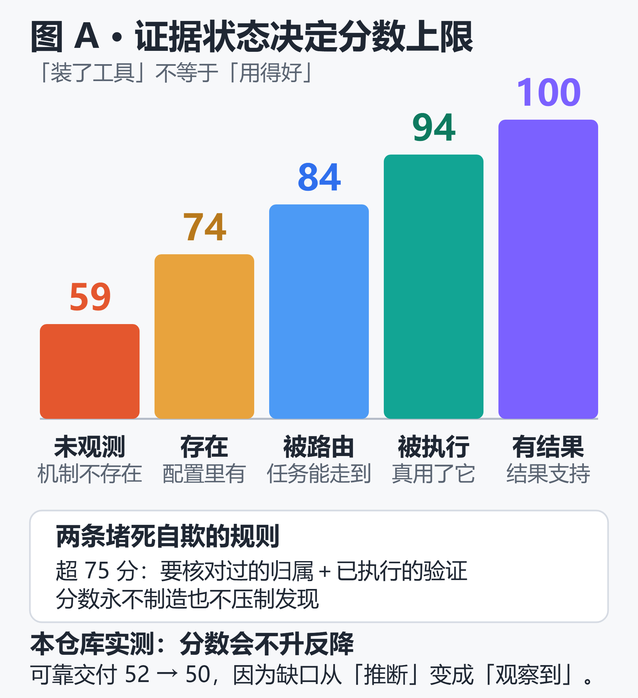
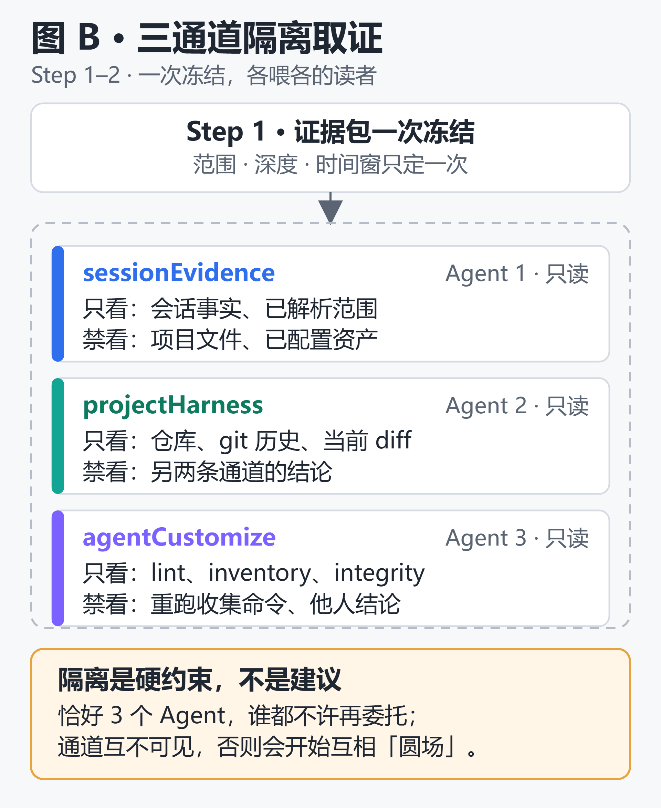
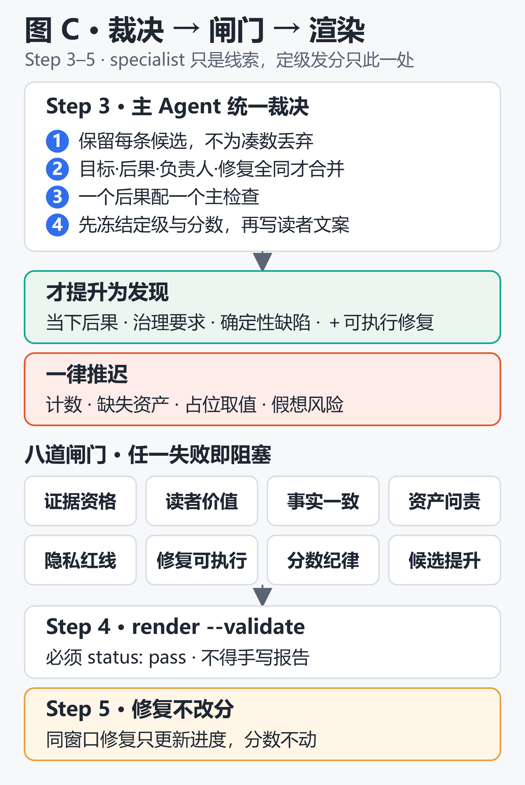
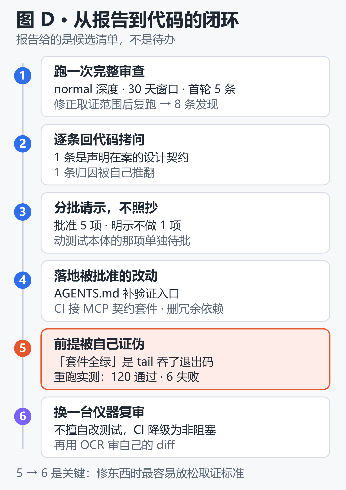

# AI 编码代理的「体检仪器」是怎么造的？——Better Harness 作用、原理与使用全解

> 写作时间：2026-10-13 ·  Better Harness 版本 `0.2.20`（npm 包 `@qoder-ai/better-harness`，MIT 许可）

Better Harness 是一个「给工作流打分」的开源插件。它把编码代理的一次交付拆成**任务理解 → 受控执行 → 变更验证 → 可靠交付 → 经验沉淀**五个维度（Agent Work Loop），用**三条互相隔离的证据通道**（会话证据、项目 Harness 证据、Agent 定制证据）分别由三个只读 subagent 独立取证，最后由主 Agent 按八道质量闸门裁决成一份「每条结论都必须带着可核对证据 + 最小负责人 + 可执行修复提示 + 验收路径」的发现清单。

它最反直觉的设计是**证据状态决定分数上限**：配置存在只给到 74 分，被实际路由到 84，被执行过 94，只有后续可比结果改善才允许 100——所以「装了工具」永远不等于「用得好」。

代价是它对证据残缺极度保守：本机首次审查时，会话证据通道报 `eligibleSessions: 0`，整个经验沉淀维度被压到 38 分，报告模式直接标为 `session-limited`——而事后核对发现，这个「空」并不是项目没有活动，而是采集器把 Qoder 主目录默认解析成 `.qoder`，与本机的 `.qoder-cn` 不符（详见 5.1 的纠错复跑）。

第六章把这份报告真正落成了一遍代码，结果比报告本身更有说服力：**批准修复的前提「契约测试全绿」是我没核对退出码就说出去的一句错话**，往下挖还挖出「这套测试对真实仓库有破坏性写」和「摄入器与 lint 器规范口径相斥」两件事——报告给的是带证据的候选清单，不是待办，而修复动作要用与审查同一套证据纪律复审。

---

## 一、它解决什么问题：diff 之外的五个系统性薄弱点

AI 编码代理改代码很快，但围绕代理的**工作流**才是薄弱环节。只看最终 diff，你根本发现不了下面这些问题（README 原话归纳）：

| 症状 | 表面现象 | 真实根因 |
|------|---------|---------|
| 🎯 目标模糊 | 代理信心十足地解决了错误的问题 | 缺验收边界定义，「完成」无判据 |
| 🧭 执行路径随意 | 工作沿着他人无法复现的路径推进 | 缺受支持的启动/运行/诊断入口 |
| ✅ 只有「能运行」 | 验证不完整或完全缺失 | 缺与最终变更相关的检查证据 |
| 🚀 速度压过保障 | 审查与交付检查被绕过 | 缺合并前的机械门与人工审批 |
| 🧠 经验没有沉淀 | 同样的问题下个任务再来一遍 | 缺可复用负责人（Skill/Memory） |

这五类问题都不会出现在最终 diff 里。Better Harness 审的是 diff 背后的工作流：收集项目证据（宿主支持时再加会话证据），评估五个相互关联的维度，把具体差距按优先级列成发现——每条都绑定证据、预期结果、修复边界和验证路径，让团队一次只改一个问题。

它的理论底座是 [Harness Engineering 的前馈/反馈闭环](https://martinfowler.com/articles/harness-engineering.html#FeedforwardandFeedback)：

- **前馈指引**——`AGENTS.md`、spec、Skill、验收标准，在代理行动**之前**为其指明方向；
- **反馈传感器**——linter、测试、Hook、评估代理，在代理行动**之后**观察结果并帮助其自我纠正。

### 一句话区分它与「代码质量工具」

SonarQube 类工具问的是「这段代码写得好不好」；Better Harness 问的是「**你的代理能不能自己把活干完、干对、干得可复现**」。前者审产物，后者审生产线。

---

## 二、评估模型：Agent Work Loop 的 5 个维度、15 个检查项

这是理解整个工具的关键。`models/agent-work-loop.md` 定义了 5 个维度、每维 3 个检查，共 15 个稳定 ID（ID 是存储身份，读者标签可以变，ID 不能改名）。

| 维度 | ID | 它回答的问题 | 三个检查项（ID） |
|------|-----|------------|-----------------|
| **任务理解** | `task-understanding` | 代理是否理解预期结果、应用了正确的权威上下文、并停留在明确的范围边界内？ | 意图与验收（`goal-understanding`）；相关上下文（`relevant-context`）；范围边界（`scope-boundary`） |
| **可控执行** | `controlled-execution` | 代理能否通过受支持的路径启动并操作项目，同时停留在被强制的权限与操作边界内？ | 可复现启动（`instruction-led-start`）；受支持操作（`supported-operation`）；权限边界（`permission-boundary`） |
| **变更验证** | `change-validation` | 代理是否运行了与最终变更相关的验证、用可用的可观察性诊断并修复失败、修复后重新验证？ | 相关验证（`relevant-check`）；失败诊断与修复（`failure-repair`）；修复后再验证（`validate-again`） |
| **可靠交付** | `reliable-delivery` | 当前结果是否在其真实交付边界被验收，是否有与风险匹配的审批和可用的回滚/恢复路径？ | 交付验收（`acceptance-evidence`）；高危审批（`high-risk-approval`）；回滚或恢复（`rollback-recovery`） |
| **经验沉淀** | `learning-capture` | Harness 能否检测生命周期/重复/维护机会，把有支撑的机会变成可复用改进，并保持这些改进长期有效？ | 生命周期机会检测（`lifecycle-repeat-detection`）；闭环工程（`loop-engineering`）；纵向验证（`later-validation`） |

审查单元是**任务过程片段（Task Episode）**：一个用户目标 + 一个可观察的验收边界。它可以跨多轮甚至多个会话，但每条断言都必须绑定在同一个目标、同一批动作、同一个结果上。明令禁止两类偷懒：不得因为多个目标发生在同一个会话里就合并它们，也不得把聚合计数当作代理行为来陈述。

### 最硬核的设计：证据状态决定分数上限

模型定义了七种证据状态，并且给前四个「当前任务维度」设定了**绝对分数天花板**（`models/agent-work-loop.md`）：

| 最高支撑证据 | 分数上限 | 含义 |
|------------|---------|------|
| `Missing` / `Unobserved` / `Not applicable` | **59** | 机制不存在，或观察边界无法判断 |
| `Present` | **74** | 机制存在（配置里有） |
| `Wired` | **84** | 相关任务/触发器/负责人路径能走到它 |
| `Exercised` | **94** | 有片段或检查实际用了它并留下了结果 |
| `Outcome-supported` | **100** | 后续可比结果支持了所声称的效果 |

三条补充规则，堵死了常见的自欺路径：

1. **超过 75 分额外要求**「已核对的源码或测试归属 + 已执行或显式提供的验证路径」——光有配置文件到不了 75 以上；
2. **分数永不制造或压制发现**：发现需要「已核对的缺口 + 有界影响 + 与负责人对齐的最小修复 + 验证路径」四件齐全，计数、文件名、资产存在与否、churn、年龄、分数都不构成发现；
3. **一个严重问题映射到一个主检查**（归属规则），但这是「一个问题一个主检查」，不是每检查或每维度的上限——同一问题的重复证据要去重，不同成因必须分开。

经验沉淀维度单独用 35–100 的整数，且**35 分下限只表示「做完了有界的经验沉淀审查」**，不给发现、状态、资产计数或已配置机制发任何分数。

> README 里那句「已配置的资产可以证明某种机制存在，但只有与任务关联的证据才能证明该机制被使用过，或确实改善了结果」，在代码层面就是这么执行的。



---

## 三、工作原理：三通道隔离取证 + 主 Agent 单点裁决

### 3.1 架构为什么必须是三个 Agent



```
证据包（一次冻结）
   ├─ lane: sessionEvidence   → Agent 1（只看会话事实）
   ├─ lane: projectHarness    → Agent 2（只看仓库/历史/diff）
   ├─ lane: agentCustomize    → Agent 3（只看已配置资产）
   └─ lane: lead analyzer     → 主 Agent（Step 3 裁决）
```

`SKILL.md` 对隔离下的是**硬约束**，不是建议：

- Step 2 的证据阶段**恰好三个**被委托 Agent，且**任何证据 Agent 都不得再委托**；
- Agent 1 只允许拿到会话事实和已解析范围，**不得**看到完整证据包、项目文件、已配置资产、原始会话或别人的 brief；
- Agent 2 只允许看项目通道 + 目标 + 历史边界 + 决策与风险，**不得**看 Session 或 Agent Customize 的结论；
- Agent 3 只允许看 Agent Customize 的 lint/inventory/integrity 三种信封，**不得**重新运行收集命令，也**不得**看 Session/Project 的结论；
- 若运行时不提供独立 Agent，则「本地独立地跑同样三份 brief」，不许合并。

这么做的理由是防止证据污染：一个通道看到另一个通道的结论后，就会开始互相圆场。「项目有 41 个 Skill」这个事实如果泄漏给会话通道，它会把「没找到重复工作流」合理化成「反正有 Skill 兜着」。

### 3.2 五个步骤

**Step 1 — 解析范围，一次性收集证据包**

```bash
better-harness harness evidence-bundle \
  --workspace <target> --language <locale> --depth <quick|normal> \
  --since <window-start> --until <window-end> --format json \
  [--include-memories] [--canvas-out <run-dir>/canvas.json]
```

深度只有两档：**quick** 用 3 个资产或 Episode、覆盖 7 天；**normal** 用 5 个、覆盖 30 天。默认基线**包含**只读的用户/全局资产与已安装插件元数据；而 Memory 正文、原始会话、市场浏览、历史洞察都**需要显式授权范围**。`--include-memories` 只放标题元数据进来，两个选项都不授权读正文。

两条重要语义：

- **计数只路由检查，不制造发现或分数**——Rules、Skills、MCP、Memory、Agents、Hooks、Commands、Workflows、Plugins 的数量为零或很高，都不构成发现；
- **`coverageRows` 才是活动清单**。若历史输入提到另一个 provider，保留其标签但**不改**当前计数、发现或分数。

运行目录必须落在 `<target>/.qoder/better-harness-runs/` 下，临时存储不算持久报告。

**Step 2 — 跑三条独立证据通道**（见上）

失败语义按深度分档：quick 允许部分或不可用，但要**显式标出**，同时降低置信度；normal 只要有任何一个 specialist 处于部分或不可用状态就**阻塞**。含项目 Memory 的 normal 报告，若 integrity 阶段不可用则直接阻塞。

**Step 2.4 — Skill 推荐（可选但按需强制）**

三个通道跑完后，由主 Agent 自己做一次资产需求对账。只有当会话证据给出「能力对比」或「工作流归属」线索时才触发。关键约束是**先冻结需求再看库存**：先从不带库存的脱敏会话证据里定下需求，再去比对实际的内建/已配置/项目/非 Skill 负责人。这一步永不创建资产，也不打分。

**Step 3 — 主 Agent 统一裁决与重新定级**

主 Agent 是唯一的裁决者。流程要求：

1. 从**保留每一条 specialist 候选**开始（不得为了凑够 5 行或对齐三个优先动作而丢弃合格发现）；
2. 只在「同一目标 + 同一后果 + 同一负责人 + 同一修复路径」四者全同时合并；
3. 每条候选都要验证：后果、成因链、最小负责人、证据边界、置信度、验收器；
4. 分配最终严重级 + 一个主 Agent Work Loop 检查；
5. **独立于发现数量**推导维度分数；
6. 分歧和不可用证据以低置信度保留，不许抹平；
7. 冻结最终严重级和维度分数**之后**，才允许塑形优先动作、修复提示和读者文案。

lint 分类、specialist 定性都只是**线索**。计数类、缺失资产、占位符形状的取值、假想风险一律推迟；只有当保留的证据证明了**当下存在的后果**、**明确的治理要求**或**确定性的缺陷**，再加上一个已发现的**可执行修复**，才允许提升为发现。绝不允许把不支持的机制改名成后果；标题只写已被支撑的当下后果，不写更严重的未来场景。

**Step 4 — 渲染授权报告**

```bash
better-harness harness render \
  --findings <run-dir>/findings.json --mode <mode> --out <parent> \
  --run-dir <run-dir> --target <target> --validate --json
```

模式四选一：`qoder-harness`（默认）、`qoder-canvas`、`markdown`、`html`（仅当用户明确要自包含可视化）。必须拿到 `status: pass`，且**不得手写** Canvas、Markdown 或 HTML。

**Step 5 — 后续跟进**

发现绑定的修复走独立的修复后评审 Agent，它只更新「修复进度」，严重级和五个维度分数**保持不变**——同一观察窗口内的修复验证只能证明「修好了」，不能证明「闭环有效」。经验沉淀维度要等后续可比 Task Episode 才动。



### 3.3 八道质量闸门（findings-review.md）

任一闸门失败即阻塞渲染。它们是这个工具最不像「AI 生成器」、最像审计标准的部分：

| # | 闸门 | 它挡住什么 |
|---|------|----------|
| 1 | **证据资格** | 计数、搜索无果、相似度、不可用证据、检测器返回 `none`、仅面向未来的风险 |
| 2 | **读者价值**（五道标题闸门） | 不自立、不以后果为先、拿维度/状态当主语、比证据更强、编造/润色出来的标题 |
| 3 | **事实一致** | 重复计数来自不同信封；不同总体不声明测量口径；用库存计数或「零」或「推断的缺失」当原因 |
| 4 | **资产问责** | 授权范围内的非零表面漏出覆盖表；`inspectedSurfaces` 里放了没真正打开的内容；把相似线索当精确冲突上报 |
| 5 | **隐私** | 密钥、原始提示词、稳定 Session ID、绝对 home 路径、Memory 标题或路径 |
| 6 | **可执行修复** | `aiFixPrompt` 里出现未在目标或 provider 合同中发现的命令/工具/负责人；假设参考语法、profile、重启、provider 动作 |
| 7 | **分数纪律** | 用计数、配置或同窗口修复给经验沉淀/闭环有效性发分 |
| 8 | **候选提升** | 另开一个「建议」工件；把未验证的复用路径写成高于 Low 的发现 |

闸门文档要求 home 路径按 `~/...` 形式渲染，源行保持项目相对路径；长会话行只保留匿名别名、角色、时长和失败聚合（这一条实际校验器不买账，见 5.4 第五条）。第 8 道闸门特别值得注意：「5 条」是**覆盖下限，不是目标**，证据稀疏时可以更少，但禁止填充、重复，或写无支撑的缺失断言。

---

## 四、使用：入口、命令与宿主差异

### 4.1 安装

除 Qoder CLI 可复用 Qoder Desktop 内置版本外，**每个宿主都要单独装**。装完或更新后必须**新开会话/任务**让宿主重新加载插件清单。

- **Qoder Desktop**：内置分发，无需安装；v1.18.0+ 可从 Quest 侧栏进入；
- **Qoder CLI**：Desktop 已装则可用；否则走 Marketplace，或 clone 到 `$HOME/.qoder/plugins/marketplaces/`——**Qoder CN 版路径是 `.qoder-cn`**；
- **Claude Code**：`/plugin marketplace add QoderAI/better-harness` → `/plugin install better-harness@better-harness`；
- 其余受支持宿主：Codex Desktop/CLI、Cursor、GitHub Copilot CLI、Qwen Code、Pi、Kimi Code、WorkBuddy、Grok，步骤与边界在官方安装指南和宿主适配矩阵里。

动手前可以先用只读命令盘一遍本机安装状态，它不访问远程注册表也不改配置：

```bash
better-harness plugin status --host all
better-harness doctor --platform all
```

还可以生成一份给人看的安装/更新/移除计划——它**不会**被拼成 shell 命令字符串，Better Harness 也**不会**替你执行这些步骤：

```bash
better-harness plugin plan install --host qwen --surface cli --scope user
better-harness plugin verify --host qwen --surface cli
```

宿主差异会明着标出来：Cursor 在原生命令合同核对完成前只保留会话级状态；Pi 那些拿不到当前原生证据的生命周期操作，直接标成手工或不可用；WorkBuddy 没有可管理的插件生命周期入口。

### 4.2 两个入口 Skill

| Skill | 用途 | 调用方式 |
|-------|------|---------|
| `better-harness` | 完整审查/修复流程（Step 1→5） | `/better-harness 分析此项目的 AI 编码工作流并生成基于证据的报告` |
| `init` | 创建/刷新仓库的 `AGENTS.md` | `/init` |

**入口路由是关键词驱动的**，且优先级最高：提示里含 `<better-harness-fix-output>` 或旧版 fix 回调 → 走发现绑定修复；以 `init`/`initialize`/`bootstrap`/`setup harness` 开头 → 走项目基础引导，**然后停下**；无回调且以 `fix`/`repair` 开头 → 走手工直接修复；其余（审查、评估、报告、既要审查又要修）继续主流程。

### 4.3 CLI 命令面（maintainer 视角全量）

`--help` 默认只露 workflow 层，加 `--audience maintainer` 才给全量：

```
harness                  evidence-bundle, analyze, checkup, selection-profile, source,
                         task-loop-report, render, report-quality, repair-findings,
                         record-fix-output, validate-canvas
session-analysis         收集并规范化宿主会话证据
agent-customize          检查代理侧 Skills/MCP/hooks/plugins/settings/memory 表面
agent-lint               解析 AGENTS.md 与本地 Markdown 引用做指令 lint
coding-agent-practices   asset-baseline, inventory, asset-integrity
core-change-watch        change-drift, core-candidates, diff-impact, evidence-pack,
                         git-history-profile, project-profile, qoder-consistency-schema
guardrails               安装或执行可独立复制的密钥防护
```

用 `commands --json` 可以拿到机器可读的命令清单，`command describe` 拿单个命令的契约，`schema` 导出 OpenCLI schema。

关于 `init` 的判断标准值得单独说——它用的是**准入测试**：

> 如果这一行消失了，一个有能力的编码代理是否会明显更容易犯错？

不会，就删掉它，或者指向事实源。另外还有四条硬规矩：子树在命令、边界或工作流上**有实质差异**才加嵌套文件；现有文件是**用户所有的 policy，不是生成的草稿**，优先最小 diff 而不是重写；不静默削弱 `MUST`/`NEVER`/安全/发布/迁移/归属规则；**不因 `/init` 顺手归一化其他代理指令系统**。

### 4.4 报告输出差异

Qoder 与 Cursor 生成宿主原生 Canvas 报告（`report.canvas.tsx` + `canvas.json`）；Claude Code、Codex、Qwen Code、GitHub Copilot、Kimi Code 生成自包含 HTML 报告配套 Markdown，产物是 `report.html`、`report.md`、`findings.json`。缺失或不完整的证据一律显式标注。

### 4.5 三条硬边界

1. **报告分析是只读的**。直接的 Bootstrap 与 fix 路径只使用各自声明的任务局部授权，其他变更需要单独授权；
2. **负责人或必需值无法解析时就停下**，给出精确的恢复条件，**不得发明替代工件**，也不得检查内部校验器；
3. **不声称当前宿主已加载新文件**——除非用宿主的 reload 机制或新会话验证过。

---

## 五、实测：在本仓库跑两次完整审查

以下数据来自 2026-10-13 对 CodeWiki-Plus 的两次 `normal` 深度审查（窗口 2026-09-13 → 10-13，`--include-memories`）：**首轮**结论有一个被后续复跑推翻的归因，**复跑**用修正后的取证范围重取了一次证据。两轮的原始数字都保留在下面，因为「首轮为什么会错」本身就是这套仪器最值得写进文档的行为。

### 5.1 三通道各自看到什么：首轮 vs 复跑

| 通道 | 结果 | 首轮状态判读 |
|------|------|------|
| **sessionEvidence** | `eligibleSessions: 0`，Task Episode 0，候选 0 | 空 → 整体降为 `session-limited` 模式 |
| **projectHarness** | Python 210 源文件 + 85 测试文件，当前 diff 0，历史 500 commit，置信度 medium | `coreCodeRules.status: missing`，边界为推断 |
| **agentCustomize** | Skills 41、Commands 23、Hooks 8、Custom Agents 1、MCP 2、Plugins 3、Memory 标题 0 | `integrity: reviewed`，`findingCount: 0` |

首轮对会话通道的读法是：状态是 `available`、`omitted` 各预算项均为 0，于是排除了「采集失败」和「被预算截断」两种解释，剩下的结论就是「本窗口没有可录取的会话」。**这个结论是错的**，错在采集器的宿主目录解析：它默认把 Qoder 主目录解析成 `.qoder`（国际版布局），六个启用源根里五个在本机根本不存在；而本机装的是 Qoder CN，会话实际写在用户主目录下的 `.qoder-cn` 里（`projects/<slug>/*.jsonl` 与 `logs/sessions/<slug>/`）。

同一窗口加 `--qoder-home .qoder-cn` 复跑，会话通道立刻从「空」变成有实料：

| 通道 | 复跑结果 | 说明 |
|------|---------|------|
| **sessionEvidence** | `eligibleSessions: 56`、`selectedSessions: 56`、`taskEpisodes: 248`、候选 Episode 18、`emittedCandidates: 5` | 状态仍是 `available`，`omitted.candidateBudget: 13`（18 个候选里按预算发了 5 个） |
| **agentCustomize** | Skills 102、Commands 23、Hooks 5、Custom Agents 1、MCP 2、Plugins 2、Workflows 1、Memory 0 | 同一个修正顺带把全局/插件资产纳入了盘点，Skills 从 41 涨到 102 |
| **projectHarness** | 与首轮一致（212 源文件 / 85 测试文件、diff 0） | 项目通道不吃 home，两轮无差异；`agentInstructions.status: adequate` 但 `nestedSourceFileCoveragePercent: 0` |

两个连带的坑，都值得记进使用手册：

1. **`QODER_HOME` 环境变量这条路走不通**。采集器对该变量的校验只接受 basename 为 `.qoder` 或 `qoder` 的值，填 `.qoder-cn` 直接被拒；只有 `--qoder-home` 旗标生效。
2. **lead 通道的文本是旧串**。修正后 `session-analysis` 的 `sources` 已能看到 84 个会话，但汇总文本里那句「Source roots: 2 of 6 enabled roots exist」并不会跟着更新——判据只能看 `sessionEvidence` lane 的 `eligibleSessions`，不能看自然语言摘要。

按模型语义，`Unobserved` 与「项目无活动」的差别在这里变得很实在：前者是取证范围错了，后者才是真的没数据。而仪器本身**不会**替你区分这两件事——它会老老实实把「没录到」当成「没发生」来打分。

### 5.2 五维分数与 findings

| 维度 | 首轮 | 复跑 | 复跑关联发现（严重度） |
|------|-----|-----|----------------------|
| 任务理解 | 70 | 72 | agent 加载的指令里没有验证入口（Medium） |
| 可控执行 | 66 | 68 | 工具失败链未持久化（Medium）、distill-worker 权限边界无法校验（Low） |
| 变更验证 | 72 | 73 | 两个 MCP 端到端契约测试从未被收集（High）、mypy 通道至今零信号（Medium） |
| 可靠交付 | **52** | **50** | 改动可不经审批直推 develop（High）、收尾无检查即交付（Medium） |
| 经验沉淀 | **38** | **55** | 上一份报告把取证通道找错目录当成项目无沉淀（Medium） |

复跑共 8 条发现（首轮 5 条），分数变动全部来自证据状态的变化而非发现数量：

- **经验沉淀 38 → 55**：首轮贴着 35 分下限，是因为会话通道为空 → 该维度按 `Unobserved` 处理，上限 59；复跑拿到了 248 个真实 Task Episode，但「重复出现的验收证据需求」仍没有对应的已验证负责人，按模型口径 **未覆盖的适用需求（uncovered applicable demand）上限是 59**，所以 55 已接近天花板，不是「找到更多问题」。
- **可靠交付 52 → 50**：不升反降。会话证据让「改动如何收尾」第一次变得可见，而看到的恰好是**可不经任何审批直接落到 develop**、以及**以「没跑检查、没有完成标记」收尾**——合并前门仍是 `Missing`（无 CODEOWNERS、无分支保护证据，压在 59 以下），新证据只是把原来推断的缺口变成了观察到的缺口。

还有一个必须写清楚的口径陷阱：复跑报告的 `evidenceMode` **仍然标着 `session-limited`**，尽管会话通道实打实录取了 56 个会话。原因在渲染器：`evidenceMode` 由评审输入里的 `taskEpisodes` 数组是否为空决定（`taskEpisodes.length > 0 ? "session-rich" : "session-limited"`），而不是由证据通道的实测数字决定。主 Agent 把 Episode 留在 lane 里、没写进 `findings.json`，报告就会顶着「会话受限」的标签出门。**看标签不看数据，会把一次证据充分的审查读成一次证据不足的审查**——这跟首轮那个错误恰好是同一类失败的两个方向。

### 5.3 一次真实的「假阳性」，以及它为什么重要

审查产出的一条发现是「MCP 工具分发器捕获全部异常并降级为 JSON 错误，可能掩盖严重故障」，定级 Medium。

回到代码核对时，`codewiki/mcp/registry.py:3297-3311` 的 docstring 明确写着：

> `Raises: No exceptions propagate — errors are caught and returned as JSON error payloads, matching the behavior of the original call_tool in server.py.`

这是**声明在案的设计契约**，不是缺陷。按质量闸门第 1 条（证据资格）和第 2 条（不得把不支持的机制改名成后果），它不该作为「缺陷」成立。最后没按原发现修，而是转成「增强可观测性」的优化项：保留现有协议行为，改为把结构化错误事件送到 sink（当时 `pyproject.toml` 声明了 `logfire>=4.1.0` 却未在业务代码里 instrument——这条声明后来被删掉了，删完的实际收益见 6.4）。

顺带还说明另一件事：**specialist 的定性只是线索，裁决权在主 Agent**，而且主 Agent 必须能推翻 specialist——不是加分项，是流程要求。

### 5.4 render 的六道硬校验（踩坑实录）

`--validate` 会在渲染前拒绝不合规输入。两轮实测连续撞到六条：

| 校验 | 报错 | 正确值 |
|------|------|--------|
| locale | `summary.locale must be en or zh-CN` | 写 `zh-CN`，**不是 `zh`** |
| 维度标签 | `dimensions[0].label must be 任务理解` … | 中文标签必须是 任务理解/可控执行/改动验证/可靠交付/经验沉淀 |
| 产物类型 | `expectedArtifact must be one of: Code, Document, Rule, Memory, Skill, Hook, Gate, Script, Test, Eval, Workflow, Agent, Command, Config, MCP, Runbook` | 自由文本描述（如 "Core boundary configuration"）会被直接拒绝 |
| 目录洁净 | `unexpected run-directory artifact: evidence-bundle.json` | run-dir 内**只允许** `canvas.json`、`findings.json`、`report.canvas.tsx` |
| 隐私路径 | `findings[i].reason must not contain a private session id or absolute path` | **任何** `~/` 前缀都被拒，连质量闸门文档里写的「非 Memory 主目录路径渲染成 `~/...`」这种脱敏形式也不行；改成「用户主目录下的 .qoder-cn」这类相对措辞 |
| 运行目录展开 | 产物被写到 `<out>/<run-dir>/` 的两级嵌套里 | `--out` 传父目录时，`--run-dir` 必须传**叶子目录名**而不是完整路径，否则路径被拼接两次 |

第四条尤其容易中招：把证据包和日志重定向到运行目录很自然，但渲染器会因此判 fail。把它们移到父目录后一次通过 `status: pass`。

第五条最值得记：闸门文档（`references/findings-review.md` 第 5 条）明文写着「Render authorized non-Memory home paths as `~/...`」，而校验器的正则把 `~/`、`/Users/`、`C:\Users\` 一律当敏感信息拒掉。**文档口径与机器校验在这里是矛盾的**，且矛盾时机器赢——所以结论不是「照文档写」，而是「凡涉主目录，改用自然语言描述而不是给出路径」。

顺带一个 Windows 侧的环境坑：`uv run mypy` 在本机报 `uv trampoline failed to canonicalize script path`，改用 `uv run python -m mypy` 才通。这跟 Better Harness 无关，但如果 `aiFixPrompt` 里写了前者，在 Windows 上会跑不出来——正好印证质量闸门第 6 条「不得假设未发现的命令行为」。

### 5.5 用同一套标准回答「哪些值得修」

报告出来后，真正有价值的动作是**拿代码事实回头拷问每条发现**。本仓库的结论：

| 发现 | 核对结果 | 决策 |
|------|---------|------|
| mypy 未接 CI | ✅ 属实：`pyproject.toml:73` 声明依赖、`:111-117` 有 `[tool.mypy]`，`ci.yml` lint job 只跑 ruff | **立即修**（全量基线实测 519 个 error + 137 个 note，汇总在 657 行的 `.qoder/mypy-baseline.txt` → 只查变更文件 + `continue-on-error` 分阶段接入） |
| 缺 CODEOWNERS/分支保护 | ✅ 属实：根目录与 `.github/` 均无该文件 | 推荐修（治理收益大，但需管理员在 GitHub 侧配置） |
| 核心边界未配置 | ⚠️ 属实但是 Better Harness 特有概念，项目已有 `AGENTS.md` 做软约束；且插件自身的 `reportFiltering` 策略**明令禁止**把「创建/填充内部核心边界配置」作为面向用户的建议、禁止渲染那个文件名 | 改为可执行的两件事：在 `AGENTS.md` 补验证入口 + 用 `--ignore` 重跑收敛边界 |
| distill-worker 无权限边界 | ⚠️ 文件确实无 `allowedTools`，但 `:7` 已写明「在 Qoder 等不透传权限的宿主中改用 general-purpose 子代理执行」 | 降为防御性文档补充（复跑仍留 Low） |
| dispatch 吞异常 | ⚠️ 设计契约，见 5.3 | **不按原发现修**，转为可观测性增强 |
| **（复跑新增）** MCP 端到端契约测试从未被收集 | ✅ 属实：`tests/okf_regression_test.py`、`tests/smoke_test_mcp.py` 里 `grep -cE "^def test_\|^async def test_"` 均为 0，`pytest --collect-only -q` 收到 0 项——它们是仅有的 MCP dispatch 端到端套件 | 待点头后修（High：CI 的 1247 项绿灯不含任何 dispatch 契约验证）。**但修复方案后来被代码事实反转，见 6.3** |
| **（复跑新增）** 改动可不经审批直推 develop | ✅ 属实：CI 只在 PR 事件上触发，`git push` 到 develop 无门 | **明示不做**（CODEOWNERS + 分支保护这一整套用户已排除） |
| **（复跑新增）** 上一轮归因错误本身 | ✅ 属实，见 5.1 | 已修（本文章节 + repowiki 踩坑笔记） |

对照首轮那五条，复跑这张表说明一件事：**同一份代码，取证范围修正后结论的量级会重排**——原来唯一的 High（核心边界缺失）被降成两条可执行动作，而两条真正的 High（契约测试从未运行、合并前门可绕过）是在拿到会话证据之后才浮出来的。

这张表本身就是 Better Harness 的正确用法：**它给你一份带证据的候选清单，而不是给你一份可以直接照抄的待办。**

---

## 六、把发现落成代码：一次带自我证伪的闭环

5.5 那张表停在「决策」这一列就没了下文。真正动手以后又跑出一段过程，它比前面所有章节都更能说明：证据纪律对**修复动作**同样成立——包括对代理自己刚说过的话。



### 6.1 第一个被推翻的结论，是我自己上一轮说的那句「全绿」

批准批次里有「把 MCP 契约测试接进 CI」这一项，前提是「`tests/okf_regression_test.py` 当前全绿，接线只需 10 分钟」。这句话我说过，而且说错了。

错法极其普通：

```bash
.venv/Scripts/python.exe tests/okf_regression_test.py | tail -15; echo $?
```

`$?` 取的是管道**尾端** `tail` 的退出码，python 那个 1 被吞在里面。改成不经过管道——输出重定向到文件，再取码：

```
exit=1
=== 结果: 120 通过, 6 失败 ===
```

套件里有 6 条断言是红的。被批准的那个前提——「接进 CI 当阻塞步骤」——**根本不成立**：照原方案合进去，CI 立刻变红，而红的原因跟这次改动毫无关系。

这里有个值得单独记的行为差别：一到「已经在修了」，取证标准就松。审查阶段 8 条发现我逐条回了代码，一条没敢直接采信；到了修复阶段，「全绿」这句话却没核对就说了出去。**同一套纪律要盖住全部动作，不是只管「分析」那一段。**

处置方式：不去改测试让它变绿，而是把 CI 步骤降级为 `continue-on-error: true`，6 条漂移逐条写进注释，归因完成后再翻正为阻塞。

### 6.2 六条红断言的归因：五条过时，一条是产品自相矛盾

逐条核到 file:line 之后：

| 断言 | 归因 | 证据 |
|------|------|------|
| `ingest_note` 显式 `status=stable` 被拒 | 断言落后 | ADR-0013 现在要求带 `reason`，报错文案直接写明了 |
| `batch_ingest` 返回结构 | 断言落后 | 结果改为落 `report_file` |
| `doc_writer` frontmatter | 断言落后 | 有意丢弃全量 `components`，只留 `component_count` |
| `lint_wiki` 检查数 16 | 断言落后 | 现为 22 项 |
| `get_prompt` 定位方式 | 断言落后 | 现在只按 `output_dir` 寻址 |
| `raw/sources` OKF 合规报错 | **疑似真实缺口** | 见下 |

最后一条不是测试写旧了，是两个模块的规范口径相斥：

- `codewiki/mcp/tools/source_ingest.py:184-185` —— 摄入的源文档若自带 frontmatter，就原样保留，**永不回填** `type`；
- `codewiki/mcp/tools/wiki_lint.py:1924-1925`、`:1939-1941` —— `okf_conformance` 明确让 `raw/sources/` **参与** OKF 审计。

两条叠在一起的后果是：每摄入一个自带 frontmatter 的文档，知识库里就多留下一条**永不自愈**的 lint error——上面第 6 条红断言就是它的现场。这不是「把断言改弱」能了结的，要么摄入侧补回填，要么 lint 侧把这一层移出合规范围——**是个产品决策**。

一个「接个 CI 步骤」的 10 分钟任务，最后追出了一条需要人拍板的规范冲突。这基本就是 Better Harness 类发现的常态：**发现之下还有发现。**

### 6.3 往下再挖一层：那套契约测试对真实仓库是有破坏性的

另一半结论更值得警惕。`tests/smoke_test_mcp.py` 是仓里仅有的两个 MCP 端到端套件之一，它一直没进 CI，过去被理解成「忘了接」。核对代码后确认它**不能**被直接接：

- `tests/smoke_test_mcp.py:34` —— `REPO_PATH` 取的是本仓根目录；
- `codewiki/mcp/tools/analysis.py:56-64` —— `output_dir` 已收敛为 `repo_path` 的**纯函数**，调用方传的覆盖值被忽略；
- `codewiki/mcp/tools/workspace_layout.py:163-172` —— `is_foreign_output_dir` 的 docstring 把设计意图写得很直白：外部 smoke/harness 运行「不得能够左右一个仓库的知识落到哪里」，所以异地的 `output_dir` 应当被忽略；
- `codewiki/mcp/tools/analysis.py:74` —— 写入路径第一次触达时会执行 `session_ff_only`，也就是对知识库跑一次 git fast-forward。

四条合起来：**跑这个脚本 = 往本仓真实的 `repowiki/` 里写东西，顺带触发一次 git 同步。** 它还能倒过来解释此前的一次提交——`repowiki/schema.yaml` 被整体重写、`# CodeWiki 默认 schema 模板` 表头丢失，那不是人为误编辑。

这条发现也反过来改变了读报告的方式：报告里「两个端到端契约测试从未被收集」是 High，但**修法不是把它们接进 CI**，而是先做测试隔离改造（临时 repo fixture）——改造动的是测试本体，得单独批。仪器的结论和它的修复方案之间，还隔着一层代码事实。

### 6.4 声明诚实化：删掉一个「删了也还在」的依赖

顺带处理了审查里那条「声明了却没用」的发现：`pyproject.toml` 声明 `logfire>=4.1.0`，但全仓 `grep` 不到任何 `import logfire`。删掉声明、重锁之后实测：

- `uv sync --frozen` exit 0；`uv lock --check` 干净；
- logfire 4.40.0 **仍然装着** —— 它由 `pydantic-ai 2.31.1 → pydantic-ai-slim[... "logfire" ...]` 的 extras 传递带入。

所以这次删除的真实收益只有**声明图的诚实度**，安装体积一克没少。把「删了依赖」讲成「减了包袱」就是过度归因了。

同一次 `uv sync --frozen` 还顺手把此前手工 `uv pip install` 的发布工具链（twine 等四个包）剪掉了——冻结解析不认不在声明图里的东西。这类副作用值得在报告里明说，而不是等下一个人发现 `twine` 不见了。

### 6.5 修完，换一台仪器再审一遍

改完 Python/YAML 之后，用 OCR（open-code-review）的**委托模式**复审自己刚写的 diff：由 OCR 做确定性的文件筛选与规则解析，由宿主代理做实际评审推理。

```
Total files: 2   Reviewed: 2   Skipped: 0   Coverage: 100%
```

它给出 5 条发现，其中两条**与本次改动无关**，是预存在问题（第三方 action 未 pin 到 commit SHA、push/PR 双触发却没有 `concurrency` 组），一条 medium 直指 6.1 那个处置的软肋：

> `continue-on-error: true` 会静默吞掉 6 条已知失败，而注释里「Triage them, then flip to blocking」是不可执行的口头约定——两周后没人记得这一步为什么是绿的。

这条我认。临时非阻塞是必要的，但**没有回流机制的非阻塞就是慢性失明**，得挂一个可追踪的工单或者让失败在日志里自带解释。

同时它证伪了三件我担心的事，都是实测而非推断：套件耗时 8.7s（不会挤爆 job 的 20 分钟预算）；写入全部落在 `tempfile.mkdtemp` 且 `SessionStore` 是纯内存对象（CI 里跑不会写脏仓库）；退出码 wiring 正确（`return 1 if _failed else 0` + `sys.exit(main())`）。

### 6.6 这一轮的四条可迁移教训

| # | 教训 | 它对应 Better Harness 的哪条主张 |
|---|------|--------------------------------|
| 1 | **报告的结论不能直接当授权。** 8 条发现里最终只有 4 条被批准落地：1 条是假阳性，1 条归因本身错了，1 条被明示不做，1 条的修复方案被反转。 | 「specialist 的定性只是线索」——而且线索到了人类手里仍然是线索，不是命令 |
| 2 | **修复动作要用与审查同一套证据纪律复审。** 「全绿」这句话我没核对退出码就说了出去，而它正是那条 High 发现的前提。 | 证据必须绑定在正确的观测点上；管道尾端的退出码不是观测点 |
| 3 | **一条发现往下挖，往往挖出产品决策而非代码问题。** 接一个 CI 步骤最终追出破坏性写与规范口径相斥两件事。 | 「最小负责人」这一项验证，就是在追问「这事该由谁、在哪个层面决定」 |
| 4 | **非阻塞状态必须有回流机制。** 降级是诚实的处置，但没人追踪的降级会固化成失明。 | 质量闸门第 7 条「分数纪律」的同源问题：不能证明有效，就不能宣称已经解决 |

---

## 七、开放了什么，以及它现在不能做什么

### 7.1 开放的三个层次

Better Harness 开放的不只是一个斜杠命令提示词，而是三层互相衔接的东西（`README.zh-CN.md`）：

- **工程实践**——覆盖会话证据、项目 Harness、Agent 定制、闭环工程四个领域的证据与判断指南（`references/`，其 README 按证据负责人分了 Session Evidence / Project Harness / Agent Customize / Loop Engineering / Tool Runtimes 五区，并列明了历史路径的折叠与拼写纠正）；
- **评估模型**——以任务为中心的 Agent Work Loop，含证据状态、发现、评分边界和纵向验证（`models/agent-work-loop.md`，配套 `software-fluency.md`、`harness-engineering.md`）；
- **可运行实现**——规范的 `/better-harness` 工作流、证据收集器、分析器、渲染器和轻量宿主适配器。

三层共享同一条边界：已配置的资产只能证明机制存在，只有与任务关联的证据才能证明它被用过或确实改善了结果。

### 7.2 明确的局限

- **当前检查通过只证明改进措施执行过**；只有后续可比较的结果才能证明闭环真的变好了。同窗口修复不改分数。
- **历史视图展示的是已记录的趋势，不能证明改进之间存在因果关系。**
- **会话证据是 provider 限定的**。Provider-only 证据保持 provider 标签；跨 provider 合成不能把一个 provider 的缺失变成项目缺陷。
- **静态声明只证明意图或存在**，不证明可运行行为、当前健康度、强制性、交付或归属。
- 交互式 Harness Inspector 用虚构英文数据，不读取你的工作区。

### 7.3 什么时候用它，什么时候不必用

**适合**：新接手一个仓库想知道代理能不能独立干活；团队发现代理反复在同一类问题上返工；CI 看起来绿但线上事故仍来自「代理绕过验收」；想知道装了 41 个 Skill 到底有没有用。

**不适合**：只想评估代码质量（用 SonarQube/ruff/mypy 更直接）；单文件小改动（成本远大于收益）；指望它替你决定架构方向——它给的是证据和缺口，取舍仍是人的事。

---

## 附：关键事实速查

| 项 | 值 |
|---|---|
| 版本 / 包名 / 许可 | `0.2.20` · `@qoder-ai/better-harness` · MIT |
| 入口 | `/better-harness`（审查修复）、`/init`（AGENTS.md） |
| 深度档位 | quick = 3 项/7 天；normal = 5 项/30 天 |
| 评估维度 | 5 维 × 3 检查 = 15 个稳定 ID |
| 证据状态 | Present / Wired / Exercised / Outcome-supported / Missing / Unobserved / Not applicable |
| 分数天花板 | 59 / 74 / 84 / 94 / 100；经验沉淀用 35–100 整数 |
| 证据 Agent | 恰好 3 个只读，禁止再委托，互相不可见对方 brief |
| 质量闸门 | 8 道，任一失败即阻塞渲染；标题闸门 5 条 |
| 报告模式 | `qoder-harness`（默认）、`qoder-canvas`、`markdown`、`html` |
| run-dir 允许产物 | 仅 `canvas.json`、`findings.json`、`report.canvas.tsx` |
| `findings.json` 硬约束 | locale 只接受 `en`/`zh-CN`；中文维度标签固定；`expectedArtifact` 16 值枚举 |
| 只读性 | 报告分析全程只读；修复需单独授权 |
| 本机（Qoder CN）取证旗标 | 必须 `--qoder-home .qoder-cn`；`QODER_HOME` 环境变量会被校验器拒绝 |
| 本仓 MCP 契约套件现状 | `okf_regression_test.py` 126 项 = 120 通过 / 6 失败，耗时 8.7s，已以 `continue-on-error` 接入 CI；`smoke_test_mcp.py` 因会写真实 `repowiki/` 而**不得**直接接入 |
| 理论底座 | Martin Fowler Harness Engineering 的前馈/反馈闭环 |
