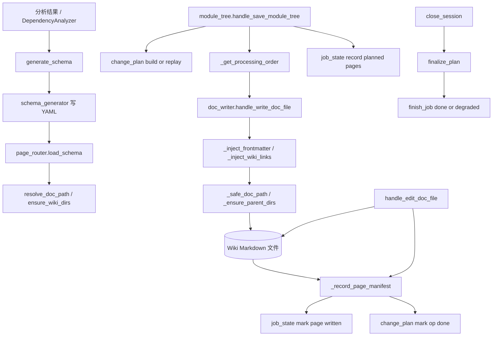

# MCP_Tools_DocWriter 模块文档

## 概述

`MCP_Tools_DocWriter` 是 CodeWiki 的文档写入、路径路由与生成状态层：把 [MCP_Tools_Analysis](MCP_Tools_Analysis.md) 与 [DependencyAnalyzer](DependencyAnalyzer.md) 产出的分析结果，转化为可落盘的 Wiki Markdown 文件，并记录一次生成任务“接下来该改什么、已经改到哪”。它包含六个子文件：`doc_writer.py`（写入/编辑核心）、`module_tree.py`（模块树、处理顺序与变更计划触发）、`page_router.py`（Wiki 路径/目录路由）、`schema_generator.py`（Wiki 结构 schema 生成）、`change_plan.py`（确定性算子计划）、`job_state.py`（页面级任务账本）。对外暴露 MCP 工具入口（`handle_write_doc_file`、`handle_edit_doc_file`、`handle_save_module_tree`、`handle_get_processing_order`、`generate_schema`）；`save_module_tree` 保存树时生成或重放 change plan，写入/编辑落盘后统一结清 page manifest、job 页面进度与计划算子。

## 组件清单

| 组件 | 类型 | 文件 | 职责 |
|------|------|------|------|
| handle_write_doc_file | 公开函数 | doc_writer.py | 写入/覆盖新文档并注入 frontmatter、wikilink；落盘后经 `_record_page_manifest` 同步 manifest、job 页面进度与 change_plan 算子状态 |
| handle_edit_doc_file | 公开函数 | doc_writer.py | 编辑已存在文档（str_replace/insert/undo）；与写入共用同一结账点，重放时可结算上一轮的 failed/skipped 算子 |
| _record_page_manifest / _inject_evidence | 私有函数 | doc_writer.py | 写入证据指纹与页面清单；把单页写入作为 manifest、job、change_plan 三套状态的统一提交点 |
| _inject_frontmatter / _inject_lightweight_frontmatter / _build_okf_frontmatter / _patch_existing_frontmatter | 私有函数 | doc_writer.py | 构造或修补 YAML frontmatter（含 OKF 兼容格式、stale_after、generated 与 sources） |
| _inject_wiki_links / _inject_crosslinks / _convert_wikilinks_to_md | 私有函数 | doc_writer.py | 注入/改写 wikilink 与跨链接，转换为标准 Markdown |
| _extract_source_refs / _resync_source_refs / _find_doc_by_basename | 私有函数 | doc_writer.py | 抽取与重同步源码引用、按 basename 定位既有页面 |
| _resolve_doc_path_safe / _safe_doc_path / _ensure_parent_dirs / _is_within | 私有函数 | doc_writer.py | 安全解析文档路径、创建父目录、越界校验 |
| _collect_wiki_terms / _save_history / _validate_mermaid / _auto_fix_mermaid / _locked_transform | 私有函数 | doc_writer.py | 收集 wiki 术语、保存历史、校验/自动修复 mermaid、锁内定点改写 |
| handle_save_module_tree | 公开函数 | module_tree.py | 保存模块树、计算顺序，并生成/复用 change_plan、记录本次尝试的欠账页面 |
| handle_get_processing_order | 公开函数 | module_tree.py | 返回模块处理顺序 |
| _collect_component_ids / _validate_module_tree / _get_processing_order / _save_and_compute_order / _change_plan_info | 私有函数 | module_tree.py | 组件覆盖校验、叶先序计算、树落盘与变更计划构建/重放（含确定性删除执行） |
| build_plan / write_plan / plan_summary | 公开函数 | change_plan.py | 由前后模块树、changed files、stale pages 与 page manifest 构建确定性算子计划；规范化 hash 决定是否复用磁盘计划 |
| execute_deletions / mark_op_done / finalize_plan | 公开函数 | change_plan.py | 工具侧执行删除；页面写入后结清算子；关闭时把遗留 pending 结算为 failed/skipped |
| start_job / set_phase / record_planned / mark_page_written / record_degraded / finish_job / job_summary / decide_resume | 公开函数 | job_state.py | 页面级任务账本：阶段、attempt、planned/written/missing、degraded 记录与 resume 档位 |
| generate_schema | 公开函数 | schema_generator.py | 生成 Wiki 目录结构 schema |
| _config_path / _detect_naming_convention / _get_defaults / _load_existing_schema / _load_project_config / _merge_schemas / _write_yaml | 私有函数 | schema_generator.py | 按语言选择 schema 模板、探测命名约定、合并已有/项目配置并写 YAML |
| resolve_doc_path / resolve_wiki_paths / compute_link_path / compute_depth | 公开函数 | page_router.py | 解析文档路径、Wiki 路径、计算链接相对路径与深度 |
| ensure_wiki_dirs / get_page_type_dir / is_wiki_system_file / load_schema / invalidate_schema_cache | 公开函数 | page_router.py | 确保目录存在、取页面类型目录、判断系统文件、加载/失效 schema 缓存 |

## 关键设计

- **路径安全优先**：所有文档写入均经 `_safe_doc_path` / `_resolve_doc_path_safe` / `_is_within` 校验，防止越出 Wiki 根目录。
- **Frontmatter 双模式**：支持完整 frontmatter 与轻量级（lightweight）模式，并兼容 OKF（Open Knowledge Format）格式。
- **Wikilink 双向转换**：写入时注入 `[[ModuleName]]` 式交叉链接，导出/编辑时 `_convert_wikilinks_to_md` 转标准 Markdown。
- **Schema 驱动路由**：`page_router.py` 依据 `load_schema` 的目录结构决定页面落盘位置与链接深度，缓存可经 `invalidate_schema_cache` 失效。
- **顺序化生成 + 计划驱动**：`module_tree.py` 通过依赖关系计算 `_get_processing_order`，保证底层模块先写；保存树时还会对比上一棵树、changed files、stale pages 与 page manifest，生成确定性 change_plan。
- **可重入编辑**：`handle_edit_doc_file` 调用 `_resync_source_refs` 重同步源码引用，避免文档漂移。
- **配置模板按语言单源**：`schema_generator._config_path` 在英文环境选 `templates/schema.en.yaml`，其余选 `templates/schema.yaml`；`_get_defaults` 用它覆盖硬编码默认值，仓库根同名文件不再回退。
- **计划驱动欠账**：有计划时，本次 attempt 只欠 `pending_pages ∪ 本 job 已写页面`；否则每个未触碰的旧模块都会被算成缺页，job 永远降级。第一棵树（无 previous tree）不生成计划，才欠全部模块页和 overview。
- **重放而非重算**：同一 job 且保存前后树完全相同，磁盘计划原样重放（未完成删除仍会重新执行）；不同 job 或树变了才重建，避免把上一轮 `failed/skipped` 的方案差异擦掉。
- **落盘在写入漏斗结账**：`handle_write_doc_file` / `handle_edit_doc_file` 落盘后统一调用 `_record_page_manifest`，在同一个点更新 manifest、job 页面进度和计划算子状态；辅助记账失败只记录告警、不阻断页面写入。
- **两级完成判定**：页面写入只说明单页完成；`close_session` 调 `finalize_plan`，把仍 pending 的算子结为 `failed`（页面仍缺）或 `skipped`（关闭时没动），再由 `finish_job` 决定 job 为 `done` 或 `degraded`。
- **两区制 skill 页面类型**：`_get_defaults` 的 `skill` 条目把 SKILL.md 草稿路由到 repowiki 根下 `skills/`（与 `notes/` 同级，进索引也进 lint），生效区 `.codebuddy/skills/` 在 repowiki 之外从不被扫描；五段骨架（工作场景 / 适用条件 / 核心 SOP / 判断逻辑 / 禁忌与反模式）缺段由 `skill_sections` lint 告警（issue #24 / ADR-0004）。

## 数据流（mermaid）



## 依赖关系

- [MCP_Server](MCP_Server.md)：注册并调度本模块暴露的 MCP 工具入口。
- [MCP_Core](MCP_Core.md)：提供工具基础框架与上下文。
- [MCP_Cache](MCP_Cache.md)：与 `page_router` 的 schema 缓存协同失效。
- [MCP_Tools_Analysis](MCP_Tools_Analysis.md) / [DependencyAnalyzer](DependencyAnalyzer.md)：提供组件与依赖数据。
- [SharedConfig](SharedConfig.md)：项目配置与命名约定来源，被 `schema_generator._load_project_config` 使用。
- [LLM_Backend](LLM_Backend.md)：文档内容生成的后端支撑。

## 使用示例

```python
import asyncio
import json

# 写入一份模块文档
written = json.loads(
    asyncio.run(
        handle_write_doc_file(
            {
                "repo_path": "/repo",
                "filename": "auth.md",
                "page_type": "module",
                "content": "# Auth\n\n...",
            },
            store,
        )
    )
)

# 保存模块树：返回 change_plan，按 pending_pages 继续生成
saved = json.loads(
    handle_save_module_tree({"repo_path": "/repo", "module_tree": tree}, store)
)
pending_pages = saved.get("change_plan", {}).get("pending_pages", [])

# 生成 wiki schema
generate_schema(project_root="/repo", wiki_root="/repo/wiki")
```

## 扩展点（新增文档写入工具）

1. 在 `doc_writer.py` 中新增 `handle_xxx_doc_file`，复用 `_safe_doc_path` / `_inject_frontmatter` 等私有辅助。
2. 若涉及新页面类型，扩展 `page_router.get_page_type_dir` 并在 `schema_generator._get_defaults` 加入默认目录。
3. 新增跨链接策略时，扩展 `_inject_crosslinks` / `_inject_wiki_links`，并同步 `_convert_wikilinks_to_md`。
4. 新全局配置项经 `schema_generator._load_project_config` 读取，并在 `_merge_schemas` 中合并；语言相关默认值走 `_config_path()`。
5. 新增变更算子时，同时扩展 `change_plan.build_plan`（生产）、`_sort_key`（执行顺序）与 `finalize_plan`（遗留结算），保持 `op_id` 和状态机不变。

## 相关模块

- [MCP_Server](MCP_Server.md)：工具注册与调度。
- [MCP_Core](MCP_Core.md)：核心框架。
- [MCP_Cache](MCP_Cache.md)：schema 缓存协同。
- [MCP_Tools_Analysis](MCP_Tools_Analysis.md)：分析数据来源。
- [MCP_Tools_Dependency](MCP_Tools_Dependency.md) / [DependencyAnalyzer](DependencyAnalyzer.md)：依赖与处理顺序。
- [MCP_Tools_Knowledge](MCP_Tools_Knowledge.md) / [MCP_Tools_Quality](MCP_Tools_Quality.md)：知识库与质量校验。
- [MCP_Prompts](MCP_Prompts.md)：提示词模板。
- [SharedConfig](SharedConfig.md)：配置中心。
- [LLM_Backend](LLM_Backend.md)：内容生成后端。
