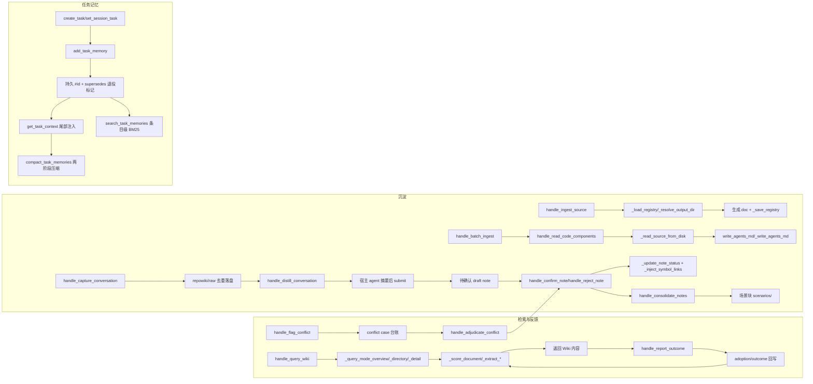

# MCP_Tools_Knowledge 模块文档

## 概述

`MCP_Tools_Knowledge` 是 CodeWiki MCP 服务的知识工具族，覆盖**沉淀 → 确认 → 检索 → 反馈**闭环：源码/AGENTS.md 生成结构化文档，raw 对话蒸馏为草稿笔记，任务记忆按用户隔离并可退役/检索，笔记冲突可立案裁决，使用结果可回写 adoption/outcome。模块横跨 note、task、distill、conflict、outcome 等多个源文件，对外暴露 `handle_*` 工具入口，内部由私有辅助支撑解析、匹配、打分、场景聚合与符号链接注入。

## 组件清单

| 组件 | 类型 | 文件 | 职责 |
|------|------|------|------|
| `handle_query_wiki` | 公开 | knowledge_loop.py | Wiki 多模式查询总入口（overview/directory/detail） |
| `handle_ingest_note` | 公开 | note_ingest.py | 接收用户笔记要点并暂存为待确认 note；ADR-0013：`status='stable'` 直写绕过 confirm 闸门时**必须**携带 `reason` 参数（意图声明，非验证机制），可选 `evidence`（`test_ref`/`commit_ref`/`reviewed_by`）锚点——提供任一已知键将 `confidence_level` 提升为 strong 并记录 `metadata.verification`，未知键拒绝 |
| `handle_confirm_note` | 公开 | note_lifecycle.py | 确认 note，注入到对应模块文档 |
| `handle_reject_note` | 公开 | note_lifecycle.py | 拒绝 note，标记状态 |
| `handle_batch_set_status` | 公开 | note_lifecycle.py | 批量把匹配的 wiki 页面/笔记从 draft 提升为 stable，追加 `verified` 事件并续 `stale_after` |
| `handle_batch_ingest` | 公开 | batch_ingest.py | 批量摄入 notes/sources；完整逐项报告落盘 `.meta/batch_ingest_report.json`，返回值仅含摘要与报告路径 |
| `handle_capture_conversation` | 公开 | capture_conversation.py | 把对话原文落盘到 `repowiki/raw/`，按 content_hash 去重并继承任务绑定 |
| `handle_distill_conversation` | 公开 | distill_conversation.py | Mode C 两阶段把 raw 蒸馏成 draft 笔记：工具不调用 LLM，宿主 agent 产出摘要后 submit |
| `handle_consolidate_notes` | 公开 | note_consolidation.py | 把已确认笔记聚合为 L2 场景块（prepare/submit），治理重复经验并保留来源 note |
| `handle_flag_conflict` | 公开 | conflict_case.py | 把两个页面之间的语义矛盾登记为一等 conflict case（claimants 必须恰好两个） |
| `handle_adjudicate_conflict` | 公开 | conflict_case.py | 裁决冲突：keep_a / keep_b / coexist / reject，并保留裁决记录 |
| `handle_report_outcome` | 公开 | outcome_report.py | 回写引用文档的实际使用结果（success/failure），驱动 adoption 与检索反馈 |
| `handle_read_code_components` | 公开 | code_reader.py | 读取代码组件（类/函数）用于文档生成 |
| `handle_view_repo_file` | 公开 | file_viewer.py | 查看仓库内文件内容 |
| `handle_ingest_source` | 公开 | source_ingest.py | 摄入源文件并建立 source→doc 注册表 |
| `handle_retract_source` | 公开 | source_ingest.py | 撤回已摄入的源文件 |
| `write_agents_md` | 公开 | agents_md.py | 生成 AGENTS.md 入口文档 |
| `_extract_*` (`_extract_frontmatter`,`_extract_frontmatter_block`,`_extract_keywords`,`_extract_section`,`_extract_tags`,`_get_module_components`,`_get_module_doc_name`) | 私有 | knowledge_loop.py | 从文档抽取 frontmatter/关键词/段落/标签与模块组件映射 |
| `_query_mode_*` (`_query_mode_overview`,`_query_mode_directory`,`_query_mode_detail`) | 私有 | knowledge_loop.py | 三种查询模式的内部实现 |
| `_` 其他辅助 (`_auto_match_modules`,`_collect`,`_walk`,`_load_symbol_map`,`_inject_symbol_links`,`_replace_symbol`,`_protect`,`_resolve_within`,`_score_document`,`_slugify`,`_legacy_keyword_search`,`_update_note_status`) | 私有 | knowledge_loop.py | 模块自动匹配、目录遍历、符号映射/链接注入、文档打分、slug 化与状态更新 |
| `_build_section` / `_extract_modules` / `_write_agents_md` | 私有 | agents_md.py | 构建 AGENTS.md 章节、解析模块列表、落盘写入 |
| `_read_source_from_disk` | 私有 | code_reader.py | 从磁盘读取源文件内容 |
| `_clean_source_refs` / `_count_source_refs` / `_load_registry` / `_resolve_output_dir` / `_save_registry` | 私有 | source_ingest.py | 源引用清理/计数、注册表加载/保存、输出目录解析 |
| `create_task` / `list_tasks` / `get_task` / `get_task_context` / `complete_task` / `delete_task` / `set_session_task` / `add_task_memory` / `compact_task_memories` / `search_task_memories` | 公开 | task_manager.py | 任务记忆工具族：任务 CRUD、会话绑定、记忆追加/上下文拉取/条目检索与两阶段压缩；ADR-0009：新条目带持久 `#id`，`supersedes` 标记旧条退役，近重复写入被拒；压缩阈值常量单源收口在 [limits.py](../../../codewiki/mcp/tools/limits.py)（ADR-0013） |
| `_read_index` / `_find_by_id` | 私有 | task_manager.py | 读取任务索引（tasks/ 目录为真相的缓存）；按 id 查找任务 |
| `_extract_frontmatter_block` | 私有 | note_query.py | 从笔记文本切出 frontmatter 块，供检索/去重前解析 |
| `_norm_status` | 私有 | note_writer.py | 规范化笔记 status 值（别名归一、非法回退） |
| `load_note_types` | 私有 | note_types.py | 从 schema 加载 note_type 定义（约束笔记类型集合） |
| `_scan_scenarios` | 私有 | note_consolidation.py | 扫描 scenarios 目录待聚合入口笔记（consolidate 前置） |
| `_parse_frontmatter` | 私有 | distill_conversation.py | 页面 frontmatter 的扁平 str→str 视图：瘦委托给 `frontmatter.parse_frontmatter`（json 解码标量，避免 `task_id: "foo"` 把引号漏进路由键），非字符串值 json 化 |
| `_unquote_fm` | 私有 | distill_conversation.py | 兼容层：剥离旧 raw 笔记中残留的包裹引号（统一 frontmatter reader 已做 json 解码） |
| `_is_retired_note` | 私有 | distill_conversation.py | OKF：已退役笔记不是知识——`deprecated` 及旧词汇 `rejected`/`superseded`（经 `note_writer._norm_status` 归一）一律跳过，避免去重时把新草稿并进死知识 |
| `load_registry` | 私有 | hook_registry.py | 读取 IDE hook 注册表（启用的 hook 清单） |

## 关键设计

1. **查询三模式**：`overview` 给目录鸟瞰，`directory` 列模块与组件，`detail` 深入单模块文档并注入符号链接。
2. **符号链接注入**：`_load_symbol_map` + `_inject_symbol_links` + `_replace_symbol` 将文档中的 `[[Symbol]]` 跨文档互链，提升可导航性。
3. **笔记闭环**：`ingest→confirm/reject` 状态机（`_update_note_status`）保证用户知识可控沉淀。
4. **源注册表**：source_ingest 维护 registry 记录 source 与生成 doc 的映射，支持 retract 回滚。
5. **AGENTS.md 自动生成**：从各模块 frontmatter 抽取组件，聚合为仓库入口文档。
6. **大载荷报告落盘**：`handle_batch_ingest` 将完整逐项结果写入 `<output_dir>/.meta/batch_ingest_report.json`，返回值仅含 `summary` 与 `report_file` 路径，避免 MCP 通道大载荷超时；调用方可用 `view_repo_file` 读取报告详情。无 `output_dir` 时退回内联 `results`。
7. **任务记忆与笔记同管**：`task_manager` 是任务记忆工具族（与笔记笔记知识同属知识沉淀闭环），索引读取走 [KnowledgeStore](KnowledgeStore.md) 的「目录为真相、缓存校验重建」约定（`_read_index`/`_find_by_id` 支撑会话绑定与上下文拉取）；压缩阈值（40 条/24KB/保留 20 条/摘要 4096 字符）与黄/橙分级（75%/87.5%）单源收口在 `limits.py`（ADR-0013），registry/prompts 中的行为契约副本由 `lint_wiki` 的 `threshold_drift` 检查守护。
8. **知识工具家族拆分**：note/task/distill/hook 从 `knowledge_loop` 大文件中拆出后各自独立成文件，仍共享同一套 frontmatter 收敛点；统一 reader 落地后，旧式手工剥引号补丁（`_unquote_fm`）降级为兼容层只处理历史遗留值。
9. **ADR-0013 直写闸门**：`ingest_note` 的 `status='stable'` 是对 draft→confirm 闸门的显式绕过，必须携带 `reason`（意图声明，写入 `metadata.reason` 供审计追溯）；可选 `evidence` 锚点镜像 `confirm_note` 语义——提供 `test_ref`/`commit_ref`/`reviewed_by` 任一即提升 `confidence_level` 为 strong 并记录 `metadata.verification`，未知键直接报错拒绝。draft 状态豁免（下游有 confirm 闸门兜底）。
10. **蒸馏提示词纪律**：`distill_conversation` 的系统提示新增第 6 条规则——每条笔记必须说明值得沉淀的理由（正文一行，如 `## Rationale`），且**永不计算**：只记录对话中明确说出的数字与结论，不做算术、计数或对已述数字的推断（ADR-0012）。
11. **任务记忆条目身份与召回**：ADR-0009 给每条记忆标题加持久 `#id`，`add_task_memory(supersedes=...)` 在旧条目下写退役标记而非删除原文；`get_task_context` 尾部注入近期条目，`search_task_memories` 在单任务 live+archive 语料上做条目级 BM25，答案是“哪条旧记忆说过 X”，且退役条目不参与打分。
12. **冲突一等公民**：`flag_conflict` 把两页矛盾写入冲突台账，`adjudicate_conflict` 以 keep_a/keep_b/coexist/reject 裁决；开放冲突由 `lint_wiki open_conflicts` 跟踪，避免矛盾长期以两份“正确”文档并存。
13. **检索反馈闭环**：`report_outcome` 记录文档被引用后的成功/失败结果，adoption 计数与检索排序据此调整；`consolidate_notes` 把 3 条以上同主题笔记聚合为场景块，防止知识库只增不治。

## 数据流（mermaid）



## 依赖关系

- [MCP_Server](MCP_Server.md)：注册并调度上述 `handle_*` 工具。
- [MCP_Core](MCP_Core.md)：复用知识库读写与文档模型。
- [MCP_Cache](MCP_Cache.md)：缓存 symbol map 与查询结果。
- [MCP_Tools_Quality](MCP_Tools_Quality.md)：文档质量校验（注入前）。
- [SharedConfig](SharedConfig.md)：仓库路径、输出目录等配置。

## 使用示例

```python
# 摄入源码并生成文档
await handle_ingest_source(repo="myrepo", paths=["src/foo.py"])
resp = await handle_batch_ingest(repo="myrepo", items=[{"kind": "source", "paths": ["src/"]}])
# resp 含 status/total/succeeded/failed 与 report_file（如 .meta/batch_ingest_report.json）
# 完整逐项结果用 view_repo_file 读取该报告

# 用户补充知识
await handle_ingest_note(repo="myrepo", text="Foo 负责鉴权", module="Foo")
await handle_confirm_note(repo="myrepo", note_id="n1")

# 查询 Wiki
result = await handle_query_wiki(repo="myrepo", mode="detail", module="Foo")
```

## 扩展点（新增知识库工具）

1. 在 `knowledge_loop.py` 新增 `handle_*` 并复用 `_extract_*`/`_score_document` 辅助。
2. 新增查询模式：扩展 `_query_mode_*` 并在 `handle_query_wiki` 分发。
3. 新的摄入源类型：仿 `source_ingest.py` 增加 registry 维护函数。
4. AGENTS.md 模板扩展：`_build_section` 支持新 frontmatter 字段。

## 相关模块

[MCP_Server](MCP_Server.md) [MCP_Core](MCP_Core.md) [MCP_Cache](MCP_Cache.md) [MCP_Tools_Quality](MCP_Tools_Quality.md) [MCP_Tools_DocWriter](MCP_Tools_DocWriter.md) [MCP_Tools_Analysis](MCP_Tools_Analysis.md) [SharedConfig](SharedConfig.md) [LLM_Backend](LLM_Backend.md)
