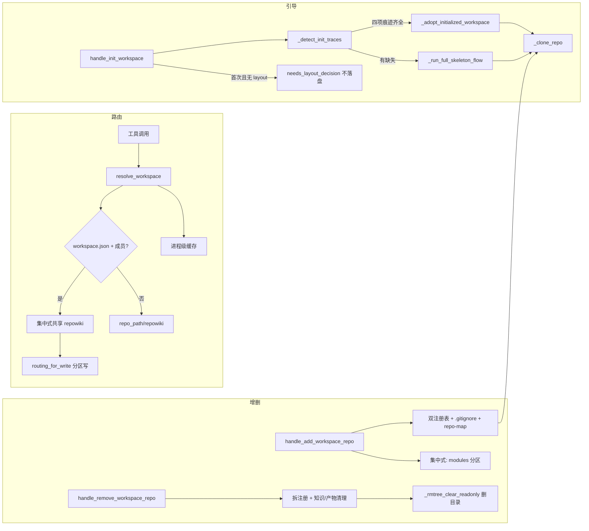

# MCP_Tools_Workspace 模块文档

## 概述
`MCP_Tools_Workspace` 是 CodeWiki 的工作区布局路由与多仓引导工具（`workspace_layout.py` + `workspace_bootstrap.py`）。前者回答「任意 repo_path/output_dir 应该落到哪个知识库根」，是集中式（centralized）与就地（colocated）布局的唯一路由接缝——每条按 `output_dir` 路由知识的工具都经 `resolve_workspace` 而非自行遍历目录。后者实现三个 MCP 工作区工具：

- `init_workspace`：首次初始化要求显式布局决策（缺 `layout` 且无既有配置时**不写任何东西**，返回 `needs_layout_decision` 交宿主询问），生成/更新 `bootstrap.sh`/`bootstrap.ps1`（repos 注册表）、`.gitignore`、`repo-map.md`、repowiki 骨架与 AGENTS.md 块；重跑时若四项初始化痕迹齐全，降级为 **clone-only 采用**（只补缺失克隆，不重建骨架）。
- `add_workspace_repo`：从 URL 推导目录名，原子式更新两个注册表、`.gitignore` 与 `repo-map.md`，默认立即克隆；集中式布局下还会在共享 repowiki 建该仓的 modules 分区，并移除仓内失效的 CodeWiki 块。
- `remove_workspace_repo`：反向拆除注册与克隆，并清理集中式知识分区、共享池 provenance 与 analyze_workspace 产物中的幽灵路由，最后删除本地目录（不可逆）。

## 组件清单

| 组件 | 类型 | 文件 | 职责 |
|------|------|------|------|
| `find_workspace_root` / `read_layout_value` / `read_layout` | 函数 | workspace_layout.py | 自起点向上查找 workspace 配置（仅 `repowiki/.meta/workspace.json` 是发现信号）；宽容读取/解析 `wiki_layout` 值（缺失/损坏/非法一律宽松回退） |
| `WorkspaceResolution` | 类 | workspace_layout.py | 解析结果（root/layout/member）；`centralized` 属性即集中式路由决策点 |
| `resolve_workspace` | 函数 | workspace_layout.py | 按四条护栏解析 repo_path：仅 workspace.json 为发现信号 / 命中仍需注册表成员资格 / 三态回退到 colocated / 进程级结果缓存（`clear_cache` 供测试） |
| `default_output_dir` | 函数 | workspace_layout.py | 集中式成员 → 工作区共享 `repowiki`；其余 → 状态维持 `repo_path/repowiki` |
| `is_foreign_output_dir` | 函数 | workspace_layout.py | 把调用方显式传入的 `output_dir` 与布局推导结果比对：不一致即 foreign，返回该外来路径供 handler 忽略并告警——外部调用（冒烟/测试）不得把某个仓的知识导向别处 |
| `is_centralized_corpus` | 函数 | workspace_layout.py | 判断 output_dir 是否落在集中式 corpus（用于门控 `repo=` 查询过滤等布局专属语义） |
| `routing_for_write` | 函数 | workspace_layout.py | 判定写入是否需要分区：仅当 repo 是集中式成员且 output_dir 恰为该工作区 repowiki 时返回注册目录名（module 页路由到共享池的依据） |
| `read_provenance` / `parse_scope_arg` / `merge_provenance` | 函数 | workspace_layout.py | 读取/规范化 `repo:`/`repos:` provenance；合并时写入 frontmatter `metadata:` 节点之下（避免 OKF lint 顶层键告警），global 清空 provenance |
| `_read_text` | 私有函数 | workspace_bootstrap.py | utf-8-sig 读取（去 BOM）+ CRLF 归一（表正则锚定 `\n` 依赖此约定） |
| `_write_text` | 私有函数 | workspace_bootstrap.py | 写脚本：`.ps1` 强制 utf-8-sig（Windows PowerShell 5.1 会把无 BOM 脚本按 ANSI/GBK 解码导致中文乱码），`.sh` 保持无 BOM（BOM 会破坏 shebang） |
| `_ensure_ps1_bom` | 私有函数 | workspace_bootstrap.py | 对 BOM 修复前生成的 bootstrap.ps1 做字节级补 BOM（内容与行尾保持逐字节不变） |
| `_load_tables` | 私有函数 | workspace_bootstrap.py | 从 bootstrap 脚本内的 repos 注册表（shell `declare -A` / PowerShell `[ordered]@{}`）按骨架行锚点解析回仓库清单 |
| `handle_init_workspace` | 公开 | workspace_bootstrap.py | 初始化/重同步工作区：首次初始化布局决策门（未给 `layout` 且无配置时返回 `needs_layout_decision` 且不落盘）、痕迹齐全时 clone-only 采用、否则走全流程 |
| `_detect_init_traces` | 私有函数 | workspace_bootstrap.py | 检测四项初始化痕迹（双 bootstrap 脚本+可解析注册表、`.gitignore`、repowiki 骨架），全齐即判定工作区已初始化 |
| `_adopt_initialized_workspace` | 私有函数 | workspace_bootstrap.py | clone-only 采用：沿用/回填布局配置、修补 `.gitignore` 排除、内容感知刷新 AGENTS.md 两个工具维护块（块外用户定制保留，内容相同不写盘） |
| `_run_full_skeleton_flow` | 私有函数 | workspace_bootstrap.py | 全流程：布局配置落盘、bootstrap 脚本与 `.gitignore` 补齐、`repo-map.md`/README/repowiki 骨架创建、AGENTS.md 块强制刷新 |
| `_clone_repo` | 私有函数 | workspace_bootstrap.py | 克隆单个已登记仓到工作区；已存在则跳过，失败只记 warning；Windows 下以 `CREATE_NO_WINDOW` 启动 git，避免弹控制台窗口 |
| `_ensure_gitignore` / `_ensure_repo_map_entry` | 私有函数 | workspace_bootstrap.py | 为登记仓补 `/<name>/` 排除行与 repo-map 导航行/章节（幂等） |
| `handle_add_workspace_repo` | 公开 | workspace_bootstrap.py | 从 URL 推导目录名，预检后事务式更新注册表/`.gitignore`/`repo-map.md`，默认立即克隆；集中式下建 modules 分区并移除仓内 CodeWiki 块 |
| `handle_remove_workspace_repo` | 公开 | workspace_bootstrap.py | 反向拆除注册表条目、`.gitignore` 行、repo-map 行与章节，清理集中式知识分区/provenance 与 analyze_workspace 产物，最后删目录（不可逆） |
| `_rmtree_clear_readonly` | 私有函数 | workspace_bootstrap.py | `rmtree(onexc=...)` 处理器：清只读位后重试（Windows 上 git pack 文件只读） |

## 关键设计

- **单一路由接缝**：所有按 `output_dir` 路由知识的工具必须经 `resolve_workspace`，禁止自行遍历目录猜测；bootstrap 注册表本身**不是**发现信号——无 `workspace.json` 的目录一律按 v5.5.0 状态维持处理。
- **成员制**：workspace 根下的目录名必须出现在注册表才路由集中式，游离 clone（如意外落在工作区树内的第三方仓库）不会被误纳入共享知识库。
- **字节级 BOM 纪律**：`.ps1` 必须有 BOM（否则 Windows PowerShell 5.1 按 ANSI 解码把中文变乱码直到脚本无法解析）；`.sh` 绝不能有 BOM（破坏 `#!/` shebang）。`_ensure_ps1_bom` 对历史文件做字节级修复。
- **骨架行共享**：模板与手建工作区共用同一批注册表骨架行（`_SH_TABLE_RE`/`_PS_TABLE_RE`），任何改动必须同步模板与正则，保证注册表可被可靠回读；目录名受 `_NAME_RE` 约束（同时作 shell 键与 gitignore 模式，免引号）。
- **三态回退**：找不到 workspace / 非成员 / colocated 都回到 `repo_path/repowiki`，保证集中式功能对存量单仓完全惰性。
- **初始化痕迹与两种重跑模式**：`_detect_init_traces` 以双 bootstrap 脚本（注册表可解析）+ `.gitignore` + repowiki 骨架（`wiki/` + `schema.yaml`）四项痕迹判定“已初始化”；全齐时 `init_workspace` 走 clone-only 采用（不重建骨架、不回写布局），否则走全流程。手建工作区因共用同一批骨架行锚点也能被识别。
- **AGENTS.md 工具维护块**：两个采用路径都会刷新 conventions 块与 CodeWiki 使用块，但只改 marker 内的内容、块外用户定制保留，内容相同时不写盘——存量工作区重跑即可升级模板，不必手工修改。
- **不可逆操作的反向清理**：`remove_workspace_repo` 先拆注册（两个脚本 → `.gitignore` → `repo-map.md`），再清集中式知识分区与 provenance、以及 analyze_workspace 的 topology/overview 幽灵路由，最后才删目录；中途失败也优先保证注册已移除。
- **平台与语言细节**：克隆时 Windows 传 `CREATE_NO_WINDOW` 避免 git 弹出控制台窗口；删除目录前用 `_rmtree_clear_readonly` 清只读位（git pack 文件）；首次布局提问文案走 `_i18n.t`，随宿主语言切换。

## 数据流（mermaid）



## 依赖关系

- 被各 MCP 工具经 [KnowledgeStore](KnowledgeStore.md) 的 bridge（`resolve_output_dir`）消费。
- `workspace_bootstrap` 被 layout 模块惰性 import（避免加载期循环依赖），并调用 `agents_md.write_workspace_conventions`/`write_agents_md`/`remove_codewiki_block` 维护 AGENTS.md 块。
- 对应集中式布局 spec：`.scratch/centralized-wiki-layout/spec.md`。

## 使用示例

```python
from codewiki.mcp.tools.workspace_layout import resolve_workspace, routing_for_write

res = resolve_workspace(repo_path)
if res.centralized:
    out = res.root / "repowiki"  # 共享知识库
    name = routing_for_write(out, repo_path)  # 分区名 / None
```

```jsonc
// 首次初始化：返回 needs_layout_decision 时先问用户，再带 layout 重调
init_workspace(workspace_path="/work/harness", layout="centralized")
add_workspace_repo(workspace_path="/work/harness", url="git@host:team/svc.git")
remove_workspace_repo(workspace_path="/work/harness", name="svc")  // 会删本地目录
```
